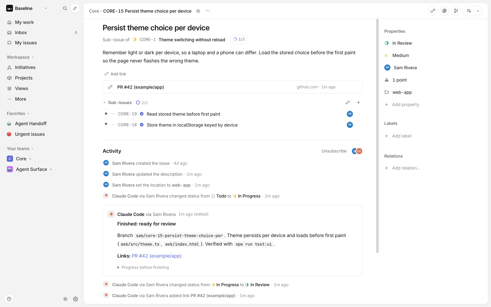
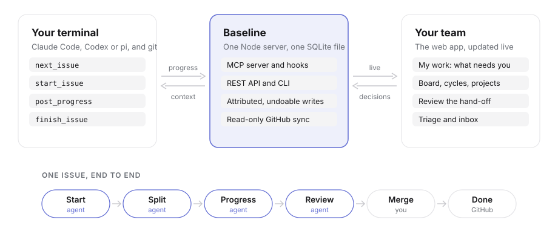
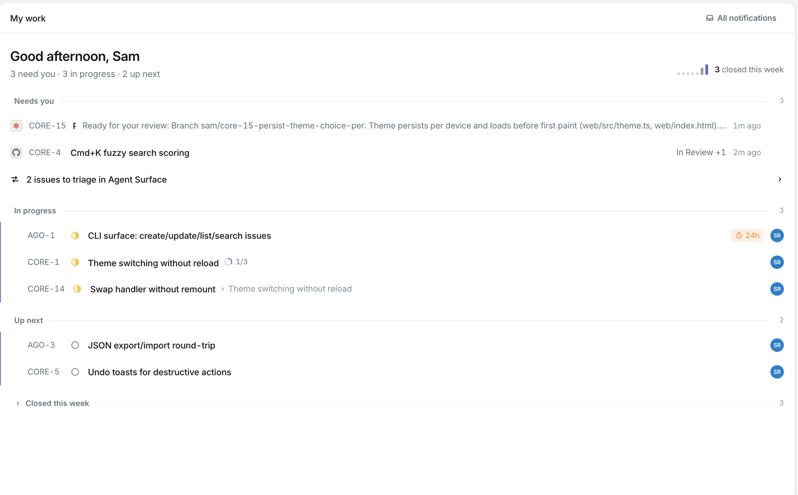
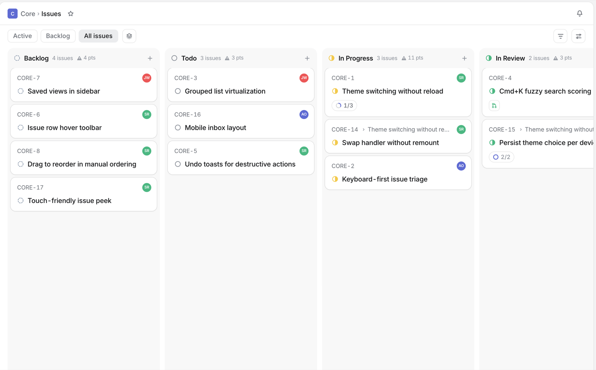
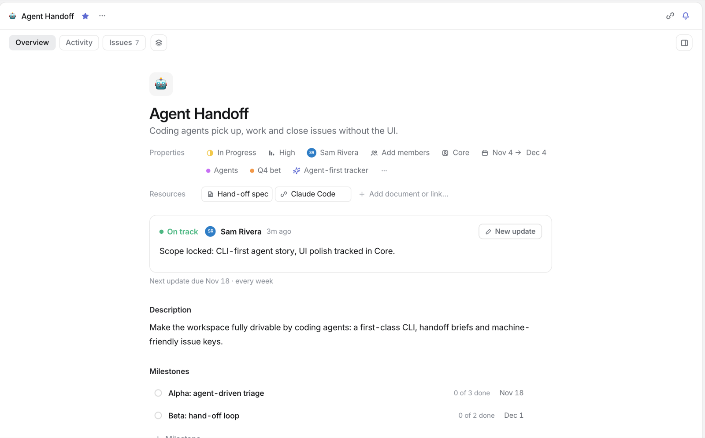
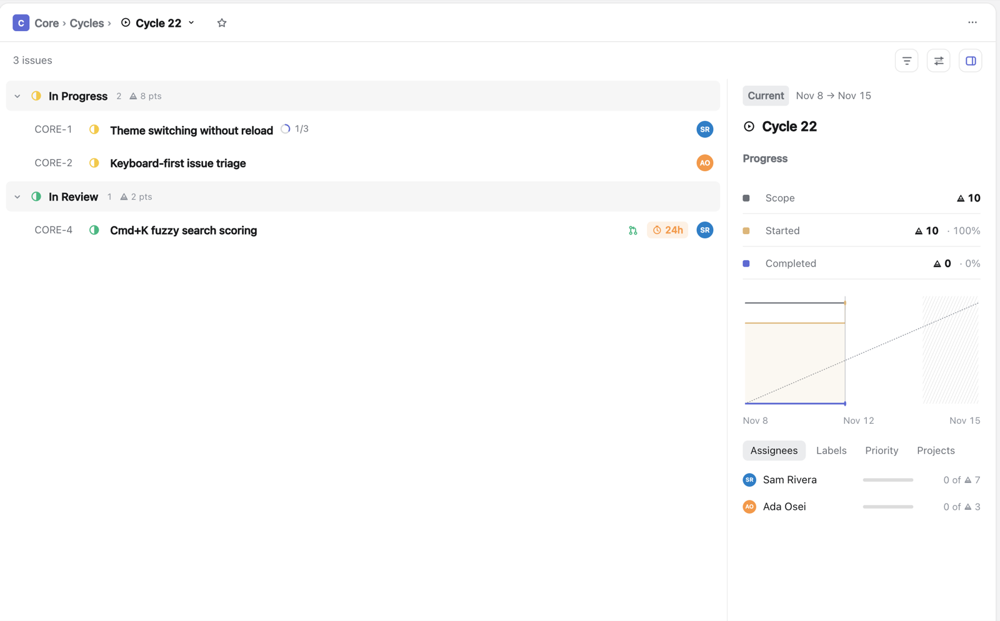

<div align="center">


# Baseline

### The issue tracker your coding agent keeps up to date.

Your agent starts the issue, checks out the branch, posts progress and hands it back for review.<br>
You open Baseline to see what's moving, decide what's next and review what came back.

[](LICENSE)
[](docs/running.md#local-development)
[](docs/agents.md)
[](#get-started)

[**Get started**](#get-started) · [**Self-host**](docs/running.md#self-host-with-docker) · [**Watch the demo**](#see-it-in-77-seconds) · [**Docs**](#documentation)

</div>

<br>

<picture>
  <source media="(prefers-color-scheme: dark)" srcset="docs/images/issue-dark.png">
  
</picture>

<br>

## Stop updating tickets. Your agent already knows what it did.

Issue trackers were built for people typing status into forms. When most of the code comes from an agent in your terminal, that typing is pure overhead, and the tracker drifts out of date by lunch.

Baseline plugs into the coding agent you already use. It tells the agent which issue the current branch belongs to, and the agent reports back as it works: it starts the issue, splits the work into sub-issues, writes a progress note, and finishes with a summary and a PR link for you to review. Your team sees all of it, live, in a fast keyboard-first web app.

- **Close to zero keystrokes.** You say "let's do CORE-15". The status, assignee, branch and progress note follow from that.
- **The tracker is always current.** Hooks give the agent the branch's issue when a session starts, and remind it to post progress when there are new commits.
- **People stay in charge.** The agent asks before it creates an issue. Every write is labelled "Claude Code via *you*" and can be undone.
- **Your data stays with you.** One Node server, one SQLite file. Run it on your laptop or on one Docker host for your team.

## How it works

<picture>
  <source media="(prefers-color-scheme: dark)" srcset="docs/images/how-it-works-dark.svg">
  
</picture>

A real session, in your words and the agent's tool calls:

| You say | The agent calls | Baseline records |
|---|---|---|
| "What should I work on?" | `next_issue` | Nothing. The agent lists your top three unblocked issues, starting with the ones in progress. |
| "Let's do CORE-15." | `start_issue` | CORE-15 moves to In Progress and is assigned to you. Its branch is created and checked out. |
| (nothing) | `create_sub_issues` | CORE-18 and CORE-19 under CORE-15. Inside an issue you started, the agent doesn't ask first. |
| (nothing) | `post_progress` | One progress note on the issue, rewritten in place after each step. |
| (nothing) | `propose_followup` | A draft for unrelated work it noticed. Nobody sees it yet. |
| "Ship it." | `finish_issue` | In Review, with the summary and the PR link. CORE-15 shows under **Needs you** in My work. The agent asks once: "I also noticed: 1. Theme flickers on the settings page in Safari. File them?" |

If GitHub is linked, merging the PR moves the issue to Done. If it isn't, a person moves it to Done after review.

<details>
<summary><b>What the agent sees when you come back the next morning</b></summary>

<br>

Open Claude Code on the branch and a hook gives the agent this before you type anything:

```text
Baseline: on branch `sam/core-15-persist-theme-choice-per` → CORE-15 Persist theme choice per device (In Progress, yours).
Last progress (18h ago): Theme is stored per device in `web/src/theme.ts`; CORE-18 done. | left: Read the stored theme before first paint (CORE-19).
Keep it current: post_progress after meaningful steps, finish_issue when you stop.
Also yours in CORE: CORE-4 Cmd+K fuzzy search scoring (In Review); CORE-1 Theme switching without reload (In Progress).
```

</details>

### See it in 77 seconds

A coding agent picks up an issue, creates a branch, splits the work, posts progress and hands it off for review, while the web app updates alongside.

https://github.com/user-attachments/assets/46c72046-dad7-42b8-9b9a-3cdfe003e780

## A tracker people want to open

The agent handles the updates. The web app is for planning, deciding and reviewing. It's fast and keyboard-first, and it will feel familiar if you've used Linear.

<table>
  <tr>
    <td width="50%" valign="top">
      <picture>
        <source media="(prefers-color-scheme: dark)" srcset="docs/images/mywork-dark.png">
        
      </picture>
      <h4>My work</h4>
      Your home page across every team: reviews waiting on you, work in progress and what's up next.
    </td>
    <td width="50%" valign="top">
      <picture>
        <source media="(prefers-color-scheme: dark)" srcset="docs/images/board-dark.png">
        
      </picture>
      <h4>Lists and boards</h4>
      Group, filter and sort any way you like, and switch between list and board with <kbd>⌘</kbd> <kbd>B</kbd>. Save any of it as a view.
    </td>
  </tr>
  <tr>
    <td width="50%" valign="top">
      <picture>
        <source media="(prefers-color-scheme: dark)" srcset="docs/images/project-dark.png">
        
      </picture>
      <h4>Projects and initiatives</h4>
      Milestones, health updates, documents and progress, grouped up into initiatives.
    </td>
    <td width="50%" valign="top">
      <picture>
        <source media="(prefers-color-scheme: dark)" srcset="docs/images/cycle-dark.png">
        
      </picture>
      <h4>Cycles</h4>
      Scheduled sprints with burn-up charts. Unfinished work rolls over to the next cycle on its own.
    </td>
  </tr>
</table>

There's also triage, an inbox, sub-issues and blockers, SLAs, recurring issues, ⌘K for everything, ⌘Z to undo any change to an issue, and a terminal UI. [FEATURES.md](FEATURES.md) lists everything that is built, along with the gaps we left on purpose.

## Guardrails, not autopilot

| Rule | What it means |
|---|---|
| 🙋 **Asks before it creates** | The agent can draft an issue at any time, but creates it only after you say yes. Sub-issues of an issue you already started are the one exception. |
| ↩️ **Every write can be undone** | Agent writes show as "Claude Code via *you*". Each one returns an `op_id` that `undo` reverses. |
| 🔒 **Read-only GitHub** | Baseline reads PRs, commits and signed webhooks. An allowlist in the code lets only read commands reach `gh`, whatever the settings. |
| 🧑‍💻 **Never runs agents** | Each engineer's own Claude Code, Codex or pi reports in. Nothing picks up an assigned issue on its own. |

## Get started

### On your laptop

You need Node.js 22.13 or later. The CLI isn't on npm yet, so install it from a checkout:

```bash
git clone https://github.com/dataguyofprocol/baseline
cd baseline
npm install && npm run build && npm install -g .
baseline serve --open
```

That opens **http://localhost:7770** on a new workspace in `~/.baseline/baseline.db`. Name your team, and load the sample data if you want something to click around in.

Then connect an agent from a repo you work in:

```bash
export BASELINE_DB="$HOME/.baseline/baseline.db"
baseline connect claude --team CORE   # your team's key, the prefix of its issue IDs
baseline doctor
claude
```

Ask **"What should I work on?"** and watch the web app update as the agent goes. The agent needs `BASELINE_DB` in its environment each time.

### For your team

Run one Docker deployment with a persistent volume. Set the server address, create the owner account with the setup token and invite your team. Email/password sign-in is built in; Google sign-in and email delivery are optional. **[Self-host with Docker →](docs/running.md#self-host-with-docker)**

Each person then connects from the repo they work in:

```bash
baseline login --server https://baseline.example.com
baseline connect claude --team ENG
baseline doctor
```

`connect` writes `.mcp.json`, the hooks in `.claude/settings.json`, `.baseline.json` and a short block in `CLAUDE.md`. None of them hold secrets or machine paths. Commit them, and each teammate only has to sign in. For other agents, use `baseline connect codex`, `baseline connect pi` or the [Baseline skill](skills/baseline/SKILL.md). **[Agent setup →](docs/agents.md)**

### From the terminal

```bash
baseline work ENG-15        # start the issue, check out its branch, open Claude Code
baseline next               # what should I work on?
baseline standup            # what I did since yesterday, ready to paste
baseline                    # the whole workspace as a terminal UI
```

The [CLI reference](docs/cli.md) has every command, plus the ones that work [against a hosted server](docs/cli.md#against-a-hosted-server).

> [!NOTE]
> Baseline is in **alpha**. The database schema and CLI can change between releases, so back up before you upgrade.

## Documentation

| Guide | Covers |
|---|---|
| [Running Baseline](docs/running.md) | Local configuration, Docker, HTTPS, backups and accounts |
| [Agent setup](docs/agents.md) | MCP tools, hooks, attribution, remote MCP and the CLI skill |
| [CLI reference](docs/cli.md) | Commands, flags, and local or server targets |
| [Core flow](CORE_FLOW.md) | Who Baseline is for and how the agent loop is meant to work |
| [Features](FEATURES.md) | Everything that's built, and the known gaps |

## Contributing

Issues and pull requests are welcome. Read [CONTRIBUTING.md](CONTRIBUTING.md) and [AGENTS.md](AGENTS.md) first, then:

```bash
npm install
npm run dev          # web app on :5183, API on :7327, using ~/.baseline/baseline-dev.db
npm run typecheck
npm run test:cli
```

Tests use scratch databases. Never seed, reset or test against `~/.baseline/baseline.db` or `~/.baseline/baseline-dev.db`. To report a vulnerability, see [SECURITY.md](SECURITY.md).

## License

[Apache License 2.0](LICENSE). © 2026 Baseline contributors.
